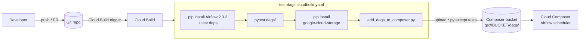

# composer-cicd

CI/CD for Cloud Composer (Apache Airflow) DAGs: Cloud Build tests the DAGs and then copies them to the
Composer environment's bucket.

## Description

This repo is a working copy of Google's sample for the
[Cloud Composer DAG CI/CD integration guide](https://cloud.google.com/composer/docs/dag-cicd-integration-guide),
taken from `GoogleCloudPlatform/python-docs-samples` (`composer/cicd_sample`) and reorganized so the DAGs sit at the
repo root and the tooling sits under `utils/`. Use it as a starting point if you keep Airflow DAGs in Git and want
every change tested and synced to a Composer environment automatically.

The DAGs target Airflow 2. The upstream guide says the same approach works on Composer 1 and Composer 2.

## Features

- **DAG validation**: a `pytest` suite imports each DAG and checks it with `cloud-composer-dag-test-utils`
  (`internal_unit_testing.assert_has_valid_dag`).
- **DAG sync utility**: `utils/dags2bucket/add_dags_to_composer.py` copies the DAG folder to a temporary directory,
  drops `__init__.py` and `*_test.py`, and uploads the remaining `*.py` files to `gs://<bucket>/dags/`.
- **Two Cloud Build pipelines**:
  - `test-dags.cloudbuild.yaml`: installs Airflow, runs the DAG tests on `python:3.8-slim`, then syncs the DAGs.
  - `add-dags-to-composer.cloudbuild.yaml`: syncs only, with no tests.
- **Two sample DAGs** (`composer_sample_dag`, `composer_sample_dag_2`): each has one `BashOperator` task that echoes
  the run id and runs daily.

## Architecture



## Requirements

- A Google Cloud project with Cloud Build and a Cloud Composer environment.
- The Cloud Build service account needs write access to the Composer environment's bucket.
- For local runs: Python 3.8 (the version the test pipeline pins, matching Composer with Airflow 2 at the time).

## Installation and quick start

1. Connect this repo to Cloud Build and create a trigger that runs `test-dags.cloudbuild.yaml` (or
   `add-dags-to-composer.cloudbuild.yaml` to skip tests).
2. Set two substitutions on the trigger:
   - `_DAGS_DIRECTORY`: path to the DAG folder, relative to the repo root (here, `dags/`).
   - `_DAGS_BUCKET`: the Composer environment's bucket name, without `gs://`.
3. Push a change under `dags/`. The build tests the DAGs and uploads them.

You can also start a build by hand:

```bash
gcloud builds submit --config test-dags.cloudbuild.yaml \
  --substitutions=_DAGS_DIRECTORY=dags/,_DAGS_BUCKET=<your-composer-bucket>
```

## Usage

Run the DAG tests locally (Python 3.8):

```bash
python3.8 -m venv .venv && source .venv/bin/activate
pip install -r utils/pytest/requirements.txt -c utils/pytest/constraints.txt
pip install -r utils/pytest/requirements-test.txt
python -m pytest -s dags/
```

Upload DAGs by hand with the sync utility:

```bash
pip install -r utils/dags2bucket/requirements.txt
python utils/dags2bucket/add_dags_to_composer.py \
  --dags_directory=dags/ --dags_bucket=<your-composer-bucket>
```

The script uploads each file to `dags/<file>.py` in the bucket and prints one line per file, or
`No DAGs to upload.` if the folder has no DAG files.

## Repository layout

```text
.
├── add-dags-to-composer.cloudbuild.yaml  # Cloud Build: sync DAGs only
├── test-dags.cloudbuild.yaml             # Cloud Build: test DAGs, then sync
├── dags/
│   ├── example_dag.py                    # composer_sample_dag (BashOperator)
│   ├── example2_dag.py                   # composer_sample_dag_2 (BashOperator)
│   └── *_test.py                         # import and validity test for each DAG
└── utils/
    ├── dags2bucket/
    │   ├── add_dags_to_composer.py       # upload utility (google-cloud-storage)
    │   ├── add_dags_to_composer_test.py  # tests for the utility
    │   ├── noxfile_config.py             # leftover config from python-docs-samples
    │   └── requirements*.txt
    └── pytest/
        ├── constraints.txt               # Airflow 2.3.3 pip constraints
        ├── noxfile_config.py             # leftover config from python-docs-samples
        └── requirements*.txt             # apache-airflow, pytest, dag test utils
```

## Configuration

| Name | Where | Purpose |
|------|-------|---------|
| `_DAGS_DIRECTORY` | Cloud Build substitution | DAG folder passed to `--dags_directory` |
| `_DAGS_BUCKET` | Cloud Build substitution | Composer bucket passed to `--dags_bucket` |
| `GOOGLE_CLOUD_PROJECT` | environment | Project used by the `google-cloud-storage` client and the upstream nox config |

Credentials come from Application Default Credentials (the Cloud Build service account in CI, or
`gcloud auth application-default login` locally). The repo has no `.gitignore` and stores no local config.

## Tests

- `dags/*_test.py` import each DAG and check that it is valid. They need Airflow 2.3.3 on Python 3.8 and were not
  run during this documentation pass.
- `utils/dags2bucket/add_dags_to_composer_test.py`: three tests run without the cloud, and three create and delete a
  temporary GCS bucket (they need credentials and a project). Running only the offline tests on 2026-10-27
  (`python -m pytest -k create_dags_list` inside `utils/dags2bucket/`) gave **2 passed, 1 error**:
  `test_create_dags_list` fails with `FileNotFoundError` because the test still looks for `utils/dags/`. The
  "folder refactor" commits moved the DAGs to the repo root.

## Status and known limitations

- **Status:** reference sample, inactive. All commits are from 2023-02-24 to 2023-02-28.
- The utility tests use the pre-refactor path (`DAGS_DIR = parent.parent / "dags/"`) and fail as described above.
- The Cloud Build steps install everything with `pip --user` on stock Python images. Versions are pinned to early
  2022 (Airflow 2.3.3, `google-cloud-storage` 2.1.0), so expect to update them.
- The sync step only adds and overwrites files. It does not delete DAGs that were removed from the repo.
- The two sample DAGs pass `"catchup=False"` as a second positional argument. Airflow reads that slot as the DAG
  `description`, so catch-up is not actually turned off. This behavior is inherited from upstream.

## License

The repo has no `LICENSE` file. The source files keep the upstream `Copyright 2021 Google LLC` Apache License 2.0
headers.
